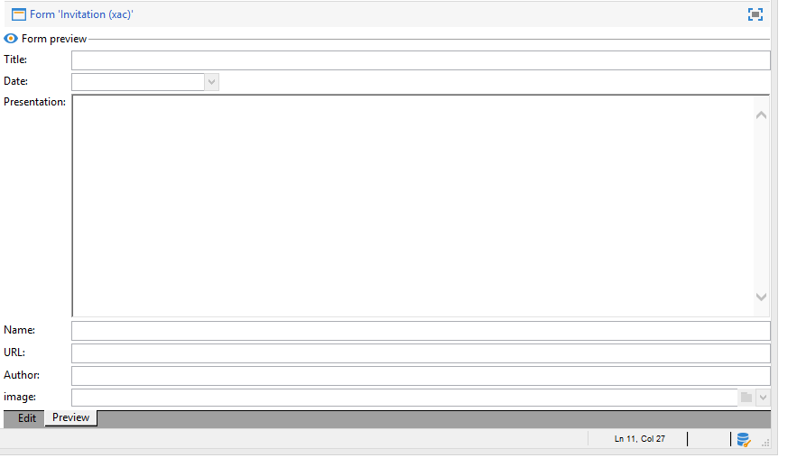
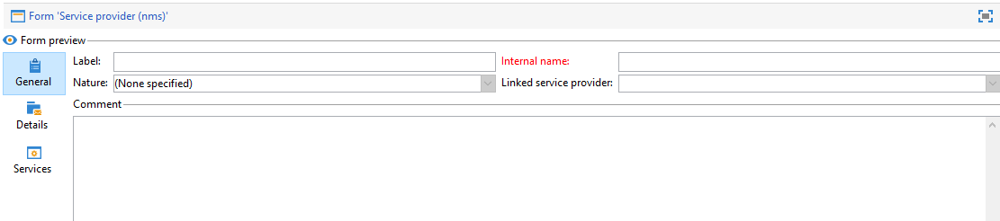
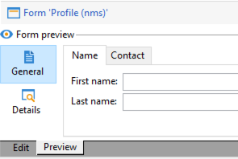

# 编辑表单{#editing-forms}

## 概述

营销人员和操作员使用输入表单来创建、修改和预览记录。 Forms显示信息的可视化表示形式。

>[!NOTE]
>
>作为从Campaign v7过渡到v8的一部分，Campaign Classic文档集已得到简化和重新组织。 现在，Campaign v8文档集中专门提供了常用功能。 要了解有关输入表单的更多信息，请参阅[Campaign v8文档](https://experienceleague.adobe.com/zh-hans/docs/campaign/campaign-v8/developer/schemas-forms/forms){target=_blank}。
>
>[](https://experienceleague.adobe.com/zh-hans/docs/campaign/campaign-v8/developer/schemas-forms/forms){target="_blank"}

您可以创建和修改输入表单：

* 您可以修改默认提供的出厂输入表单。 工厂输入表单基于工厂数据架构。
* 您可以根据定义的数据架构创建自定义输入表单。

Forms是`xtk:form`类型的实体。 您可以在`xtk:form`架构中查看输入表单结构。 要查看此架构，请从菜单中选择&#x200B;**[!UICONTROL Administration]** > **[!UICONTROL Configuration]** > **[!UICONTROL Data schemas]**。 阅读有关[表单结构](https://experienceleague.adobe.com/zh-hans/docs/campaign/campaign-v8/developer/schemas-forms/forms){target="_blank"}的更多信息（Campaign v8文档）。

要访问输入表单，请从菜单中选择&#x200B;**[!UICONTROL Administration]> [!UICONTROL Configuration] >[!UICONTROL Input forms]**：


要设计表单，请在XML编辑器中编辑XML内容：


[阅读更多](https://experienceleague.adobe.com/zh-hans/docs/campaign/campaign-v8/developer/schemas-forms/forms#formatting){target="_blank"}（Campaign v8 文档）。

要预览表单，请单击&#x200B;**[!UICONTROL Preview]**&#x200B;选项卡：


## 表单类型

您可以创建不同类型的输入表单。 表单类型决定了用户如何在表单中导航：

* 控制台屏幕

  这是默认表单类型。 该表单包含一个页面。

  

* 内容管理

  使用此表单类型进行内容管理。 查看此[用例](../../delivery/using/use-case-creating-content-management.md)。

  

* 助理

  此形式包括按特定顺序排序的多个浮动屏幕。 用户从一个屏幕导航到下一个屏幕。 [阅读更多](https://experienceleague.adobe.com/zh-hans/docs/campaign/campaign-v8/developer/schemas-forms/forms#wizards){target="_blank"}（Campaign v8 文档）。

* 图标框

  此表单包含多个页面。 要导航表单，用户请选择表单左侧的图标。

  

* 笔记本

  此表单包含多个页面。 要导航表单，用户请选择表单顶部的选项卡。

  

* 垂直窗格

  此窗体显示导航树。

* 水平窗格

  此窗体显示项目列表。

## 对图像的引用

若要查找图像，请从菜单中选择&#x200B;**[!UICONTROL Administration]** > **[!UICONTROL Configuration]** > **[!UICONTROL Images]**。

要将图像与表单中的元素（例如图标）相关联，可以添加对图像的引用。 例如，在`<container>`元素中使用`img`特性。

语法： `img="`*`namespace`*`:`*`filename`*`.`*`extension`*`"`

此示例显示对`ncm`命名空间中的`book.png`和`detail.png`图像的引用：

```xml
<container img="ncm:book.png" label="General">
[…]
</container>
<container img="ncm:detail.png" label="Details">
[…]
</container>
```

这些图像用于用户单击以导航多页表单的图标：




## 创建简单表单 {#create-simple-form}

要创建表单，请执行以下步骤：

1. 从菜单中选择&#x200B;**[!UICONTROL Administration]** > **[!UICONTROL Configuration]** > **[!UICONTROL Input forms]**。
1. 单击列表右上角的&#x200B;**[!UICONTROL New]**&#x200B;按钮。

   

1. 指定表单属性：

   * 指定表单名称和命名空间。

     表单名称和命名空间可以与相关数据架构匹配。  此示例显示了`cus:order`数据架构的表单：

     ```xml
     <form entitySchema="xtk:form" img="xtk:form.png" label="Order" name="order" namespace="cus" type="iconbox" xtkschema="xtk:form">
       […]
     </form>
     ```

     或者，您可以在`entity-schema`属性中显式指定数据架构。

     ```xml
     <form entity-schema="cus:stockLine" entitySchema="xtk:form" img="xtk:form.png" label="Stock order" name="stockOrder" namespace="cus" xtkschema="xtk:form">
       […]
     </form>
     ```

   * 指定要在表单上显示的标签。
   * （可选）指定表单类型。 如果未指定表单类型，则默认使用控制台屏幕类型。

     

     如果您设计的是多页面表单，则可以省略`<form>`元素中的表单类型，并在容器中指定类型。

1. 单击 **[!UICONTROL Save]**。

1. 插入表单元素。

   例如，要插入输入字段，请使用`<input>`元素。 将字段引用的`xpath`属性设置为XPath表达式。 [阅读更多](https://experienceleague.adobe.com/zh-hans/docs/campaign/campaign-v8/developer/schemas-forms/schema-structure#reference-with-xpath){target="_blank"}（Campaign v8 文档）。

   此示例显示基于`nms:recipient`架构的输入字段。

   ```xml
   <input xpath="@firstName"/>
   <input xpath="@lastName"/>
   ```

1. 如果表单基于特定的架构类型，则可以查找此架构的字段：

   1. 单击&#x200B;**[!UICONTROL Insert]** > **[!UICONTROL Document fields]**。

      

   1. 选择字段并单击&#x200B;**[!UICONTROL OK]**。

      

1. （可选）指定字段编辑器。

   默认字段编辑器与每种数据类型相关联：
   * 对于日期类型字段，该表单会显示输入日历。
   * 对于枚举类型字段，该表单会显示一个选择列表。

   您可以使用以下字段编辑器类型：

   | 字段编辑器 | 表单属性 |
   | --- | --- |
   | 单选按钮 | `type="radiobutton"` |
   | 复选框 | `type="checkbox"` |
   | 编辑树 | `type="tree"` |

   阅读有关[内存列表控件](https://experienceleague.adobe.com/zh-hans/docs/campaign/campaign-v8/developer/schemas-forms/forms#memory-list-controls){target="_blank"}的更多信息（Campaign v8文档）。

1. （可选）定义对字段的访问权限：

   | 元素 | 属性 | 说明 |
   | --- | --- | --- |
   | `<input>` | `read-only="true"` | 提供对字段的只读访问权限 |
   | `<container>` | `type="visibleGroup" visibleIf="`*edit-expr*`"` | 有条件地显示一组字段 |
   | `<container>` | `type="enabledGroup" enabledIf="`*edit-expr*`"` | 有条件地启用一组字段 |

   示例：

   ```xml
   <container type="enabledGroup" enabledIf="@gender=1">
     […]
   </container>
   <container type="enabledGroup" enabledIf="@gender=2">
     […]
   </container>
   ```

1. （可选）使用容器将字段分组为多个部分。

   ```xml
   <container type="frame" label="Name">
      <input xpath="@firstName"/>
      <input xpath="@lastName"/>
   </container>
   <container type="frame" label="Contact details">
      <input xpath="@email"/>
      <input xpath="@phone"/>
   </container>
   ```

   

## 创建多页表单 {#create-multipage-form}

您可以创建多页面表单。 还可以将表单嵌套在其他表单中。 阅读有关[容器、笔记本和iconbox表单](https://experienceleague.adobe.com/zh-hans/docs/campaign/campaign-v8/developer/schemas-forms/forms#containers){target="_blank"}的更多信息（Campaign v8文档）。

## 修改工厂输入表单 {#modify-factory-form}

要修改出厂表单，请执行以下步骤：

1. 修改工厂输入表单：

   1. 从菜单中选择&#x200B;**[!UICONTROL Administration]** > **[!UICONTROL Configuration]** > **[!UICONTROL Input forms]**。
   1. 选择输入表单并修改它。

   您可以扩展工厂数据架构，但不能扩展工厂输入表单。 我们建议您直接修改出厂输入表单，而无需重新创建它们。 在软件升级期间，工厂输入表单中的修改将与升级合并。 如果自动合并失败，您可以解决冲突。 [了解更多信息](../../production/using/upgrading.md#resolving-conflicts)。

   例如，如果使用附加字段扩展工厂模式，则可以将此字段添加到相关的工厂表单。

## 验证表单 {#validate-forms}

您可以在表单中包含验证控件。

### 检查必填字段

您可以检查必需信息：

* 为必填字段使用`required="true"`属性。
* 使用`<leave>`节点检查这些字段并显示错误消息。

在此示例中，需要电子邮件地址，如果用户未提供此信息，则会显示错误消息：

```xml
<input xpath="@email" required="true"/>
<leave>
  <check expr="@email!=''">
    <error>The email address is required.</error>
  </check>
</leave>
```

有关[表达式字段](https://experienceleague.adobe.com/zh-hans/docs/campaign/campaign-v8/developer/schemas-forms/forms#expression-field){target="_blank"} （Campaign v8文档）和[表单上下文](https://experienceleague.adobe.com/zh-hans/docs/campaign/campaign-v8/developer/schemas-forms/forms#context-of-forms){target="_blank"} （Campaign v8文档）的更多信息。

### 验证值

您可以使用JavaScript SOAP调用从控制台验证表单数据。 使用这些调用进行复杂验证，例如，根据授权值列表检查值。 [阅读更多](https://experienceleague.adobe.com/zh-hans/docs/campaign/campaign-v8/developer/schemas-forms/forms#soap-methods){target="_blank"}（Campaign v8 文档）。

1. 在JS文件中创建验证函数。

   示例：

   ```js
   function nms_recipient_checkValue(value)
   {
     logInfo("checking value " + value)
     if (…)
     {
       logError("Value " + value + " is not valid")
     }
     return 1
   }
   ```

   在此示例中，函数名为`checkValue`。 此函数用于检查`nms`命名空间中的`recipient`数据类型。 将记录正在检查的值。 如果该值无效，则会记录一条错误消息。 如果该值有效，则返回值1。

   您可以使用返回值修改表单。

1. 在表单中，将`<soapCall>`元素添加到`<leave>`元素。

   在此示例中，使用SOAP调用来验证`@valueToCheck`字符串：

   ```xml
   <form name="recipient" (…)>
   (…)
     <leave>
       <soapCall name="checkValue" service="nms:recipient">
         <param exprIn="@valueToCheck" type="string"/>
       </soapCall>
     </leave>
   </form>
   ```

   在此示例中，使用了`checkValue`方法和`nms:recipient`服务：

   * 服务是命名空间和数据类型。
   * 方法是函数名称。 名称区分大小写。

   同步执行调用。

   将显示所有例外。 如果您使用`<leave>`元素，则在验证输入的信息之前，用户无法保存表单。

此示例说明如何在表单中进行服务调用：

```xml
<enter>
  <soapCall name="client" service="c4:ybClient">
    <param exprIn="@id" type="string"/>
    <param type="boolean" xpathOut="/tmp/@count"/>
  </soapCall>
</enter>
```

在此示例中，输入是一个ID，它是一个主键。 当用户填写此ID的表单时，将会使用此ID作为输入参数进行SOAP调用。 输出是写入此字段的布尔值： `/tmp/@count`。 您可以在表单内使用此布尔值。 阅读有关[表单上下文](https://experienceleague.adobe.com/zh-hans/docs/campaign/campaign-v8/developer/schemas-forms/forms#context-of-forms){target="_blank"}的更多信息（Campaign v8文档）。
