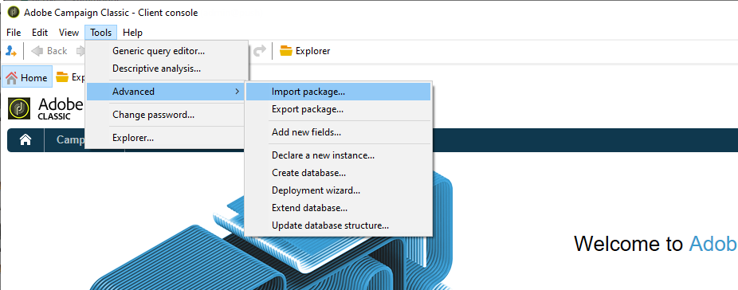
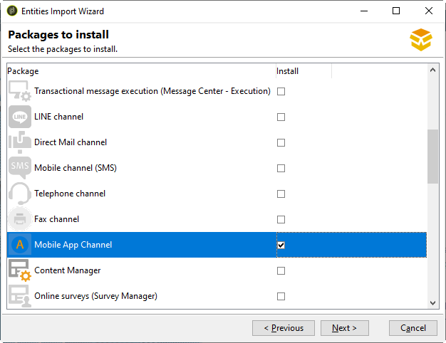
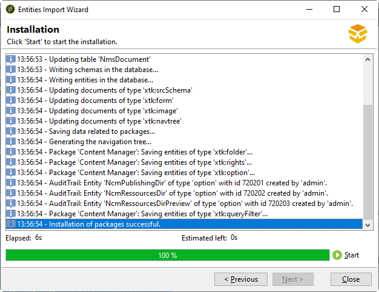

# 移动应用程序渠道入门{#about-mobile-app-channel}

使用Adobe Campaign创建推送通知投放，以向您的移动应用程序用户发送个性化消息。

>[!NOTE]
>
>作为从Campaign v7过渡到v8的一部分，Campaign Classic文档集已得到简化和重新组织。 现在，Campaign v8文档集中专门提供了常用功能。 要了解有关推送通知渠道的更多信息，请参阅[Campaign v8文档](https://experienceleague.adobe.com/en/docs/campaign/campaign-v8/send/push/push){target=_blank}。
>
>{target="_blank"}

以下信息特定于Campaign Classic。

+++ **包安装**

 [在视频中了解如何安装移动应用包](https://experienceleague.adobe.com/docs/campaign-classic-learn/tutorials/sending-messages/push-channel/installing-the-mobile-app-channel.html#sending-messages)

作为混合/托管客户，请联系[Adobe客户关怀](https://helpx.adobe.com/cn/enterprise/admin-guide.html/enterprise/using/support-for-experience-cloud.ug.html)团队以访问Campaign中的推送通知渠道。

作为内部部署客户，您需要安装内置软件包。

>[!CAUTION]
>
>在[此页面](../../installation/using/installing-campaign-standard-packages.md)中了解有关Campaign内置包、最佳实践和建议的更多信息。

安装步骤为：

1. 从Adobe Campaign客户端控制台的&#x200B;**[!UICONTROL Tools > Advanced > Import package]**&#x200B;访问包导入助手。

   

1. 选择 **[!UICONTROL Install a standard package]**。

1. 在显示的列表中，选中&#x200B;**[!UICONTROL Mobile App Channel]**。

   

1. 单击&#x200B;**[!UICONTROL Next]**，然后单击&#x200B;**[!UICONTROL Start]**&#x200B;以开始安装包。

   安装包后，进度条显示&#x200B;**100%**，您可以在安装日志中看到以下消息： **[!UICONTROL Installation of packages successful]**。

   

1. **[!UICONTROL Close]**&#x200B;安装窗口。

完成此步骤后，您可以配置Android和iOS应用程序。 请参阅Campaign v8 [文档](https://experienceleague.adobe.com/docs/campaign/campaign-v8/send/push/push.html){target="_blank"}。

+++

+++ **故障排除**

如果移动设备已连接到Wi-Fi并且未收到通知，请检查防火墙是否未阻止FCM/APNs端口。

**Android**：移动设备连接到端口5228到5230上的FCM服务器。 因此，必须配置防火墙以授权与FCM的连接。 要打开的端口为：5228（最常用）、5229和5230。

**iOS**：

HTTP/2连接器：必须允许与以下服务器之间的通信：

* api.push.apple.com：端口443
* api.development.push.apple.com：端口443

>[!NOTE]
>
>有关这两个连接器的更多信息，请参阅Campaign v8 [文档](https://experienceleague.adobe.com/docs/campaign/campaign-v8/send/push/push-settings.html){target="_blank"}。

+++
