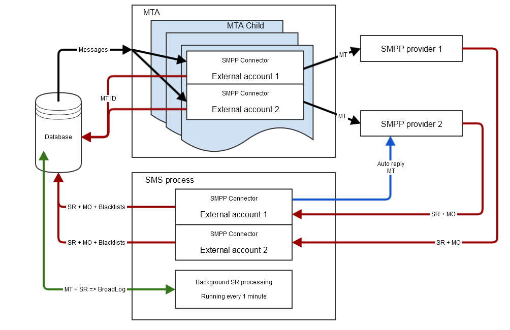

# 短信连接器协议和设置 {#sms-connector-protocol}

>[!NOTE]
>
>通过此文档，所有对协议、字段名称和值详细信息的引用都引用[SMPP 3.4规范](https://smpp.org/SMPP_v3_4_Issue1_2.pdf)。
>

作为从Campaign v7过渡到v8的一部分，Campaign Classic文档集已得到简化和重新组织。 现在，Campaign v8文档集中专门提供了常用功能。 要了解有关SMS连接器设置的更多信息，请参阅[Campaign v8文档](https://experienceleague.adobe.com/en/docs/campaign/campaign-v8/send/sms/config-sms/smpp-external-account){target=_blank}。

[](https://experienceleague.adobe.com/en/docs/campaign/campaign-v8/send/sms/config-sms/smpp-external-account){target=_blank}

## 概述 {#overview}

SMS可能仅限于发送无格式的短文本消息，但其简单性使其成为有价值的通信渠道。

发送短信有两种主要方式：

* 通过电话手动发送，这是人们直接沟通的常用方式。
* 通过Adobe Campaign发送消息的方式从互联网发送。 为此，您需要一个SMS服务提供商来将Internet连接到移动网络。
Adobe Campaign使用SMPP协议向服务提供商发送短信。

本文档将指导您逐步完成Adobe Campaign与SMPP提供商之间的连接设置。

SMPP提供商有时可能会偏离官方规范，但Adobe Campaign中的SMS连接器提供了许多选项来调整其行为，以便与大多数提供商兼容。

>[!IMPORTANT]
>
>建立与新提供商的连接可能需要一些技术技能、TCP知识、二进制、十六进制表示和文本编码。 它还需要与提供者积极合作。

## SMPP协议 {#smpp-protocol}

Adobe Campaign Classic支持SMPP协议版本3.4。 这是一种广泛使用的协议，允许向提供商(SMSC)发送SMS并接收SMS和接收。 有关详细信息，请参阅[SMPP文档](https://smpp.org/SMPP_v3_4_Issue1_2.pdf)。

SMS服务提供商端的网络设备通常称为SMSC。

### SMPP连接 {#smpp-connections}

Adobe Campaign通过TCP连接到SMS服务提供商的网络设备。 SMPP协议设置从Adobe Campaign到提供程序的永久TCP连接。 TCP连接始终由Adobe Campaign启动，即使接收消息也是如此。
SMPP会打开1或2个TCP连接，具体取决于其模式。 所有连接始终由Adobe Campaign启动。

SMPP协议可以两种模式工作：

* **发送器+接收器（或TX+RX）**：使用两个单独的TCP连接来发送和接收消息。
* **收发器（或TRX）**：单个TCP连接用于发送和接收消息。

>[!NOTE]
>
> Adobe Campaign Classic仅支持TX+RX模式。 此限制是由于其技术架构造成的。

### SMPP PDU {#smpp-pdu}

SMPP传输单元（“数据包”）称为PDU。 **PDU**&#x200B;包含命令、状态、序列号和数据。

每个PDU必须由`SMPP RESP PDU`确认（同步响应）。 可以管道化请求：发送者可以发送许多命令而无需等待`RESP`，可以随时管道化的请求数称为窗口。 `RESP PDU`可以任意顺序到达，与其对应的启动器PDU的顺序无关。

在分隔的&#x200B;**发送器+接收器**&#x200B;模式下，使用的连接取决于发送的消息类型。 发送器连接用于MT，接收器连接用于MO和SR。 通过同一TCP连接发送每种消息的请求和响应。

例如，在发送MT时，将使用发送器连接，并且还会通过发送器通道发送确认MT的`RESP`。 当您收到MO（或SR）时，接收器连接用于接收MO并发送确认MO的`RESP`。


在Adobe Campaign Classic中，要将SR与其对应的MT关联，SMSC将返回一个ID，其中包含`SUBMIT_SM_RESP`和`DELIVER_SM`步骤。 该标识符存储在`nms::providerMsgId`表的`providerId`字段中，并链接到`broadLogId`和`deliveryId`。 此匹配操作由SMS进程在写入数据库时完成。

成功的`SUBMIT_SM_RESP PDU`在发送日志中触发“已发送”消息状态，而成功的`DELIVER_SM (SR) PDU`触发“已接收”消息状态。

### 安全方面 {#security-aspects}

协议本身不加密。 大多数提供商在允许列表上实施IP的变体，因此必须向提供商声明Adobe Campaign服务器IP地址。

Adobe Campaign支持在绑定阶段传递登录名和密码。 它还支持SMPP而不支持TLS。 需要注意的是，要获得适当的安全性，需要证书。 虽然SMPP连接器允许绕过证书检查，但应仅将其用于测试，因为没有证书的TLS提供了显着较低的安全级别。

连接器使用系统`openssl`库提供的默认证书。 通常由Debian上的`/etc/ssl/certs`目录提供。 默认情况下，“ca-certificates”包会提供此目录，但可以对其进行自定义。

### 各种PDU中的信息 {#information-pdu}

每种PDU都有不同的字段，这些字段包含不同的信息。 这些PDU在[SMPP 3.4规范](https://smpp.org/SMPP_v3_4_Issue1_2.pdf)中有详细说明。

以下每个部分都描述了PDU及其同步响应(`*_RESP PDU`)。 所有PDU都必须由相应的`RESP`确认，这是规范的强制部分。

PDU可以有可选字段。 此处只介绍最常见的字段。 有关详细信息，请参阅[SMPP 3.4规范](https://smpp.org/SMPP_v3_4_Issue1_2.pdf)。

**BIND_TRANSMITTER / BIND_RECEIVER / BIND_TRANSCEIVER**

此PDU用于启动与SMSC的连接。 **发送器**、**接收器**&#x200B;和&#x200B;**收发器**&#x200B;模式仅更改允许通过此连接传输的SMS类型，特别是：

| 模式 | 允许的短信类型 |
|:-:|:-:|
| 发射器 | MT |
| 接收器 | MO + SR |
| 收发器 | MT + MO + SR |

`BIND_* PDU`中值得注意的字段：

* **system_id**：用于身份验证的登录。 在外部帐户中设置。

* **密码**：用于身份验证的密码。 在外部帐户中设置。

* **system_type**：对于某些提供程序，需要设置为特定值。 在外部帐户中设置（在所有版本中均可用）。 通常区分不同类型的合同、渠道、国家/地区等。

* **addr_ton**&#x200B;和&#x200B;**addr_npi**：某些提供程序需要它们。 由外部帐户中的`Bind TON`和`Bind NPI`设置设置。

* **address_range**：某些提供程序需要此项。 大多数情况下，这是此连接上允许的短代码列表。 在外部帐户中设置。

`BIND_*_RESP`没有特定字段，它确认连接是否成功。

#### 取消绑定 {#unbind}

此PDU必须在断开连接之前由系统发送。 它必须等待匹配的`UNBIND_RESP` PDU才能关闭连接。

符合SMSC的不得关闭连接，TCP连接由Adobe Campaign连接器控制。

#### SUBMIT_SM {#submit-sm}

此PDU向SMSC发送MT。 其响应PDU提供MT的ID。

`SUBMIT_SM` PDU中的重要字段：

* **service_type**：某些提供程序需要。 在投放属性中设置。

* **source_addr_ton**&#x200B;和&#x200B;**source_addr_npi**：指示传输的源地址类型。 这些字段的含义是标准化的，但由于某些提供商使用字段的方式有所不同，因此您应该要求提供商提供其正确的值。 在外部帐户中设置。

* **source_addr**： MT的源地址/ oADC。 那个显示在手机上。 在外部帐户和投放中设置，投放中的值优先于外部帐户的值。

* **dest_addr_ton**&#x200B;和&#x200B;**dest_addr_npi**：指示传输的目标地址类型（例如，本地或国际格式）。 这些字段的含义是标准化的，但由于某些提供商使用字段的方式有所不同，因此您应该要求提供商提供其正确的值。 在外部帐户中设置。

* **destination_addr**：收件人地址、电话号码或MSISDN。

* **esm_class**：用于判断文本字段中是否使用了UDH。 如果未使用`message_payload`模式，则连接器会自动启用拆分短信。

* **priority_flag**：此邮件的优先级高于其他邮件。 这与投放本身的优先级相关联。

* **validity_period**：时间戳，超过该时间后不应再尝试重试。 在投放本身中设置。

* **registered_delivery**：告知是否请求了SR。 Adobe Campaign始终设置此标记，但自动回复除外。 对于多部分消息，只为第一部分设置标志。 所有版本都具有相同的行为。

* **data_coding**：指示文本字段中使用的编码。 有关详细信息，请参阅[短信文本编码](https://experienceleague.adobe.com/en/docs/campaign/campaign-v8/send/sms/sms-channel#sms-text-encoding){target="_blank"}（Campaign v8文档）部分。

* **short_message**：消息的文本。 如果使用UDH，则其中还包含UHD标头。

Adobe Campaign支持以下可选字段：

* **dest_addr_subunit**：用于指定SMS的目标：闪存、移动或SIM卡。 在投放属性中设置。

* **message_payload**：在外部帐户中启用时，将在单个PDU中发送长消息，文本将在此字段而不是`short_message`字段中传输。

#### SUBMIT_SM_RESP {#submit-sm-resp}

此PDU将包含MT的ID。 这有助于将其与传入SR匹配。

>[!IMPORTANT]
>
>许多提供商以十六进制格式传输MT ID。 确保在外部帐户中正确设置MT确认&#x200B;**中的** ID格式。

某些提供商在发送SR后发送`SUBMIT_SM_RESP`。 为了解释该行为，Adobe Campaign在将&#x200B;**无效的消息ID**&#x200B;回复到具有未知ID的SR之前等待了30秒。

#### DELIVER_SM {#delivery-sm}

此PDU由SMSC发送到Adobe Campaign。 它包含MO或SR。

大多数字段与其对应的`SUBMIT_SM`字段具有相同的含义。 以下是有用字段的列表：

* **source_addr**： MO/SR的源地址。 通常这是一个电话号码。

* **destination_addr**：接收MO或SR的短代码。

* **esm_class**：用于判断PDU是MO还是SR。

* **short_message**：消息的文本。 对于SR，这包含SMPP协议规范的附录B中描述的数据。 有关详细信息，请参阅[SR错误管理](sms-protocol.md#sr-error-management)。

Adobe Campaign能够通过某些配置读取`receipted_message_id`可选字段中的消息ID。

#### DELIVER_SM_RESP {#deliver-sm-resp}

此PDU由Adobe Campaign发送，用于确认SR和MO。

将SR和MO插入数据库后，Adobe Campaign Classic会确认它们。 即使发送了成功的`DELIVER_SM_RESP` PDU，也可能会发生一些处理错误。 此限制是由Adobe Campaign Classic的软件架构造成的。

#### ENQUIRE_LINK {#enquire-links}

此PDU仅用于检查连接是否处于活动状态。 其频率应根据提供商的需求进行设置。

默认的60秒应与外部帐户中设置的大多数配置匹配。

#### INQUIRE_LINK_RESP {#enquire-links-resp}

此PDU确认连接处于活动状态。

### 多部分SMS（长短信） {#multipart}

>[!IMPORTANT]
>
> Adobe Campaign仅支持发送多部分短信或长短信。 传入的SMS (MO)不支持UDH和`message_payload`，这意味着MO限制为160个字符。

### 吞吐量上限和窗口 {#throughput-capping}

大多数提供商都要求为每个SMPP连接设置吞吐量限制。 通过在外部帐户中设置大量短信即可实现此目的。 请注意，吞吐量限制发生在每个连接上，总有效吞吐量是每个连接的限制乘以连接总数。 [同时连接](sms-protocol.md#connection-settings)部分中对此进行了详细说明。

要达到最大可能的吞吐量，您需要微调最大发送窗口。 发送窗口是无需等待`SUBMIT_SM_RESP`即可发送的`SUBMIT_SM PDU`数。 有关更多详细信息，请参阅[发送窗口设置](https://experienceleague.adobe.com/en/docs/campaign/campaign-v8/send/sms/config-sms/smpp-external-account#smpp-delays){target="_blank"}（Campaign v8文档）部分。

### 服务请求和错误管理（“附录B”） {#sr-error-management}

SMPP协议在`RESP PDU`中定义了标准同步错误，但它没有为SR定义错误代码。 每个提供商都使用自己的错误代码及其含义。

在[SMPP协议规范](https://smpp.org/SMPP_v3_4_Issue1_2.pdf)（第167页）的附录B部分提出了建议，但这不会列出实际错误代码，也不会列出其含义。

为适应错误管理，已利用Adobe Campaign的broadlog消息系统正确配置错误及其严重性（硬、软等）。

如上所述，有两种不同的错误：

* 将消息发送到SMSC后立即在`SUBMIT_SM_RESP`中同步回复
* 可能在移动设备收到消息或消息超时后很晚发生的回执。 在这种情况下，该错误可在SR中找到。

收到SR时，可在其`short_message`字段中找到状态和错误（例如，附录B合规性实施）。 PDU的`short_message`字段通常称为&#x200B;**文本字段**，因为它包含MT中的文本。 对于SR，它包含技术信息以及名为&#x200B;**Text**&#x200B;的子字段。 这2个字段不同，`short_message`实际包含&#x200B;**文本**&#x200B;字段和其他信息。

Adobe Campaign Classic连接器（扩展SMPP除外）使用取决于所选提供商的硬编码行为。 通用SMPP只区分成功和错误，不提供任何详细信息。 投放日志可能包含一些不保证的信息。

#### SR文本字段格式 {#sr-text-field-format}

该规范建议对SR文本字段使用此格式。 它是子字段的列表，用冒号分隔以分隔字段名称及其值。 字段名称不区分大小写。

与附录B推荐匹配的SR文本字段示例：

```
id:1234567890 sub:001 dlvrd:001 submit date:1608011415 done date:1608011417 stat:DELIVRD err:000 Text:Hello Adobe world
```

ID字段是在`SUBMIT_SM_RESP PDU`中收到的ID，即MT的确认。

`sub`和`dlvrd`应该计算已传递部件和已传递消息的数量，但Adobe Campaign不使用此数量，因为broadlog系统提供了更好、更完整的信息。

`submit date`和`done date`字段是指示性时间戳，指示何时发送MT以及移动设备何时发送SR。 可能出现时区问题，甚至是日期集不正确的移动设备所给的时间戳错误。

stat字段非常重要，因为它可告知消息的状态。 唯一重要的状态为`DELIVRD`、`UNDELIV`和`REJECTD`。 `DELIVRD`状态表示成功，其他两个状态表示错误。 其他值是可能的，但它们通常是中间通知，例如MT到达移动运营商，而不是移动电话。 Adobe Campaign会忽略这些中间通知。

错误字段包含特定于提供程序的错误代码。 提供程序必须提供一份可能的错误代码表及其含义，才能解释此值。

最后，文本字段通常包含MT文本的开头。 Adobe Campaign忽略了这一点，并且一些提供商不传输此消息以避免PII泄漏和网络带宽消耗。 在故障排除期间，可通过阅读此字段更轻松地识别与测试MT匹配的SR。

### Adobe Campaign Classic Extended generic SMPP中的SR处理示例 {#sr-processing}

此示例显示了遵循附录B建议的实施案例、外部帐户中的默认值和成功的SMS MT。

```
id:1234567890 sub:001 dlvrd:001 submit date:1608011415 done date:1608011417 stat:DELIVRD err:000 Text:Hello Adobe world
```

首先，应用`id extraction`正则表达式以提取ID并将其与相应的MT进行协调。

然后，应用`status extraction`正则表达式和`error code extraction`正则表达式以提取这些字段并将其附加到字符串中。

broadlog消息是使用此信息构建的，并且会将原始的未更改字符串附加在一起以供参考：

```
SR ExampleProvider DELIVRD 000|MESSAGE=id:1234567890 sub:001 dlvrd:001 submit date:1608011415 done date:1608011417 stat:DELIVRD err:000 Text:Hello Adobe world
```

然后，对消息进行标准化，删除MESSAGE部分，以便能够将多个消息与相同的状态和错误代码进行匹配。

```
SR ExampleProvider DELIVRD 000|#MESSAGE#
```

如果尚未在broadlog消息表中配置该消息，则将创建一个新条目，并将整个消息用作&#x200B;**firstText**&#x200B;和规范化的消息。 然后，连接器使用成功和`error`正则表达式来确定它是成功还是失败：

* 如果与`success`正则表达式匹配，则将其视为成功。

* 如果与`error`正则表达式匹配，则该消息将被限定为错误。

* 如果这两个正则表达式都不匹配，则会忽略SR。 它可能是中间通知，Adobe Campaign不处理它。

默认情况下，所有错误均设置为软错误。 这意味着必须手动配置硬错误。

## SMPP外部帐户参数 {#SMPP-parameters-external}

SMPP协议的每个实施都有许多变体。 为了提高兼容性和适应性，提供了许多设置以更改SMPP连接器的行为。 本节介绍每个参数及其对连接器的影响。

### 常规参数和路由 {#general-parameters-routing}

**限制此帐户的MTA实例**

可以设置允许连接到SMPP提供商的MTA实例数限制。 选中后，您可以指定最多可以使用多少MTA。

此选项允许更精确地控制连接数，请参见[同时连接](sms-protocol.md#connection-settings)。

如果设置的值高于正在运行的MTA的数量，则所有MTA都将以正常方式运行：此选项只是一个限制，不会生成其他MTA。

如果您需要精确控制连接数（如提供程序要求），则建议始终设置此选项，即使当前部署运行了正确数量的MTA也是如此。 如果之后添加其他MTA，则连接限制仍将遵守。

### 连接设置 {#connection-settings}

#### SMSC 实施名称 {#smsc-implementation-name}

设置SMSC实施的名称。 它应设置为您的提供商的名称。 联系管理员或可投放性团队以了解要在此字段中添加的内容。 此字段的角色在[SR错误管理](sms-protocol.md#sr-error-management)部分中描述。

>[!NOTE]
>
>可交付性团队的参与基于合同，客户应联系其Adobe代表以获取与可交付性参与相关的信息。

#### MTA 子连接数 {#number-mta-child}

在Adobe Campaign Classic中，它定义每个MTA子级的连接数。

Adobe Campaign Classic Extended SMPP连接器可以控制每个MTA子级的连接数。 要控制连接的全局限制，您必须限制MTA子进程的数量，这通常意味着为SMS提供专用的中间源平台。

对于Adobe Campaign Classic，可能存在其他数量的接收器和发射器连接：

* **发射器连接= MTA子连接数* MTA子进程数* MTA数（如果已设置自动回复）* MTA子连接数**

如上所述，如果启用了自动回复，Adobe Campaign Classic短信进程将打开更多发送器连接。 这些额外的连接用于发送自动回复。

* **接收器连接= MTA子连接数**

如果您设置自动回复，短信流程将打开发送方/接收方对，从而增加发送方连接的数量。 如果未设置任何自动回复，则仅会打开接收器连接。

#### 通过 SMPP 启用 TLS {#enable-TLS}

使用TLS连接到提供程序。 连接将被加密。 TLS连接由OpenSSL库管理，任何适用于OpenSSL的内容对于此连接都将为true。

#### 在日志文件中启用详细的 SMPP 跟踪 {#enable-verbose-log-file}

此设置将所有SMPP通信转储到日志文件中。 在初始设置过程中，通常需要调整参数。 在对连接器进行故障诊断并与提供商的通信记录进行比较时，必须启用此功能。

在Adobe Campaign Classic中，日志输出位于MT相关流量的MTA日志中，以及MO和SR相关流量的短信日志中。

### 接收器连接设置 {#receiver-connection}

此部分仅在分隔的&#x200B;**发射器+接收器**&#x200B;模式下可见。

#### 为接收器使用不同的参数 {#receiver-parameters}

如果未选中该框，则会对发射器和接收器使用相同的设置。

选中该框后，**连接设置**&#x200B;部分中的设置将应用于发射器，**接收器连接**&#x200B;设置中的设置将应用于接收器。

**接收服务器，端口，帐户，密码，系统类型**

这些设置适用于处于发射器+接收器模式的接收器。 它们的工作方式与发射器部分类似，请参阅上面了解更多详细信息。

### SMPP 渠道设置 {#smpp-channel-settings}

#### 将传入MO存储在数据库中 {#incoming-mo-storing}

启用后，传入的MO将存储在数据库的inSMS表中。 可使用任何工作流的查询活动来查询此表。

Adobe Campaign Classic始终将所有MO存储在inSMS数据库中，因此此选项不可用。

#### 在SR处理期间启用实时KPI更新 {#real-time-kpi}

启用后，当收到错误SR时，将在主投放页面上实时更新KPI。

其缺点可能是由于它产生的数据库争用而导致性能降低。 如果禁用，**syncfromexec**&#x200B;工作流将更新统计信息，每20分钟运行一次。

Adobe Campaign Classic具有完全不同的KPI机制，因此此选项不可用。

#### 短代码 {#short-code}

指示帐户的主要短代码。 如果此帐户使用了多个短代码，或者如果短代码未知，请将此字段留空。

指定短代码对以下两项功能很有用：

* 如果未提供源号码，则预览将显示短代码。 那个反映的是手机上的真实行为。

* 自动回复功能的“阻止列表”设置只会将特定短代码的隔离用户发送到。

### SMSC详情 {#SMSC-specifics}

这些设置是高级设置，可使Adobe Campaign连接器适应大多数SMPP实施特点。

#### 跳过TLS证书检查 {#skip-tls}

启用TLS后，跳过所有证书检查。

选中后，连接不再安全，在生产环境中不应启用连接。

它可用于调试或测试目的。

您可以在三个不同的证书验证值之间进行选择：

* 完整的认证检查（包括主机名），默认。
* 跳过主机名验证。
* 跳过证书验证。

#### 应用正则表达式来确定成功/错误状态 {#regex-applied}

当遇到具有未知stat/err字段组合的消息时，这些正则表达式将应用于stat字段以确定SR是成功还是错误。 如果其stat值与这些正则表达式中的任何值都不匹配，则会忽略SR。

默认情况下，以`DELIV`开头的stat值（如[附录B](sms-protocol.md#sr-error-management)中的`DELIVRD`）将被视为已成功交付，而所有与错误（如`REJECTED`、`UNDELIV`）匹配的stat值将被视为错误。

#### MT确认中的ID格式 {#id-format-mt}

这表示`SUBMIT_SM_RESP PDU`的`message_id`字段中返回的ID的格式。

* **请勿修改**：该ID在数据库中以ASCII编码文本的形式按原样存储。 不进行预处理或过滤。

* **十进制数**：ID应为ASCII格式的十进制数。 使用此设置时，将删除前导和尾随空格以及前导零。

* **十六进制数字**：ID应为ASCII形式的十六进制数字，不能以0x开头，也不能以h结尾。 然后，该ID在存储到数据库中之前被转换为十进制数。

* **十六进制字符串**： ID应为ASCII编码的文本，其本身是编码为十六进制的字节字符串。 例如，在PDU中，您将找到`0x34 0x31 0x34 0x32 0x34 0x33`，这将转换为ASCII“414243”。 然后，此字符串被解码为字节的十六进制字符串，您因此获得“ABC”：您将在数据库中存储ID“ABC”。

#### SR中的ID格式 {#id-format-sr}

这表示由SR中ID的`Extraction`正则表达式捕获的ID的格式。 值与上述MT中的格式具有相同的含义和行为。

**可选字段**&#x200B;中的SR ID或错误代码

>[!NOTE]
>
>仅在Adobe Campaign Classic Extended SMPP连接器中可用。

如果选中，可选字段的内容将附加到上述正则表达式处理的文本中。 文本的格式为`0xTAG:VALUE`，`0xTAG`是标记的4位十六进制值，用大写表示，如`0x002E`。

例如，您可能希望捕获`receipted_message_id`字段中的ID。 为此，请启用此复选框，并将以下文本添加到状态：

```
0x001E:05e3299e-8d37-49d0-97c6-8e4fe60c7739
```

在本例中，0x001E是可选字段的标记，UUID是字段的值。

为了捕获此值，您现在可以在SR字段中ID的提取正则表达式中设置以下正则表达式：

```
\b0x001E:([0-9a-f]{8}-[0-9a-f]{4}-[0-9a-f]{4}-[0-9a-f]{4}-[0-9a-f]{12})\b
```

>[!IMPORTANT]
>
>您只能捕获具有文本(ASCII/UTF-8)值的可选字段。 具体而言，使用当前的正则表达式系统无法可靠地捕获二进制字段。

**服务ID标记**

允许添加自定义TLV。 此字段设置标记部分。 可以在每次投放的高级参数的&#x200B;**服务或程序ID**&#x200B;值中自定义该值。

此设置仅允许每条消息添加一个TLV选项。

### 自动回复发送至 MO {#automatic-reply}

>[!IMPORTANT]
>
>在Adobe Campaign Classic和混合架构中，对扩展SMPP连接器应用自动回复需要为&#x200B;**外部帐户**&#x200B;文件夹上的mid运算符添加写入权限。

此功能允许快速回复文本到MO，并处理每个短代码发送到。

**关键字**&#x200B;和&#x200B;**短代码**&#x200B;列定义条件以触发自动回复。 如果两个字段匹配，则会发送MO并触发其他操作。 要指定通配符，应将字段留空。 关键字与MO文本中的第一个字母数字单词匹配，忽略标点和前导空格。 这意味着&#x200B;**Keyword**&#x200B;字段不能包含空格，并且必须是单个单词。

**关键字**&#x200B;设置是前缀。 例如，如果您指定“AD”，则会匹配“AD”、“ADAPT”和“ADOBE”。 如果您有多个具有相同前缀的关键字，则需要注意顺序，因为关键字是从上到下处理的。

**Reply**&#x200B;列是要回复的文本。 此字段中没有可用的个性化设置。 如果您将此字段留空，将不会回复任何消息，但将仍触发其他操作。

当&#x200B;**关键字**&#x200B;和&#x200B;**短代码**&#x200B;都匹配时，**附加操作**&#x200B;列会提供一个附加操作，空短代码与所有短代码匹配。 您可以发送隔离或从隔离中删除，值none对文本不回复。 如果您指定了&#x200B;**其他操作**，但将&#x200B;**回复**&#x200B;字段留空，则将执行该操作，但不会发送回复。 仅对指定的短代码应用隔离，如果字段留空，则对所有短代码应用隔离。

>[!IMPORTANT]
>
>“发送完整电话号码”设置会影响自动回复隔离机制的行为：如果未选中“发送完整电话号码”，则被隔离的电话号码将带有加号(“+”)，以使其与国际电话号码格式兼容。

表中所有条目都按指定的顺序进行处理，直到一个规则匹配为止。 如果多个规则匹配一个MO，则仅应用最顶层的规则。

## 短信投放模板参数 {#sms-delivery-template-parameters}

某些参数可以根据投放模板进行设置。

### 投放参数 {#delivery-parameters}

#### 传输方式 {#transmission-mode}

此字段指示您要传输的SMS类型：普通消息或闪存消息，存储在移动设备或SIM卡上。

此设置在`SUBMIT_SM PDU`的`dest_addr_subunit`可选字段中传输。

* **未指定**&#x200B;在PDU中未发送任何可选字段。

* **Flash**&#x200B;将该值设置为1。 它会发送一条在手机上弹出且未存储在内存中的闪存消息。

* **Normal**&#x200B;将该值设置为0。 它会发送一条正常消息。

* **Save on mobile**&#x200B;将该值设置为2。 它告知手机将短信存储在内存中。

* **保存在终端**&#x200B;上将值设置为3。 它告知手机将短信存储在SIM卡中。

#### 有效期 {#validity-period}

有效期在`SUBMIT_SM PDU`的`validity_period`字段中传输。 日期始终采用绝对UTC时间格式，日期字段将以“00+”结尾。

## 扩展的通用SMPP连接器 {#acc-extended-connector}



箭头表示数据流。

发送投放部分时，MTA会生成MTA子项。 MTA子进程的数目是动态的，取决于serverConf.xml中的配置。 每个MTA子实例化连接到SMPP提供程序的连接器`CSmppConnectorWorker`。 只要MTA子项保持活动状态（也可以在serverConf.xml中配置），连接就会保持活动状态。

SMS进程仅处理SR，它连接到提供商并保持连接打开。 该进程每10分钟重新连接一次，以重新加载新设置，这是正常操作。

### 匹配MT、SR和broadlog条目 {#matching-mt}

中间表`nmsProviderMsgId`用于在异步提交到broadlog之前临时存储MT和SR数据。

`nmsProviderMsgId`表有3组列：

* 发送和确认MT时更新的列： `iBroadLogId`，`iDeliveryId`

* 收到SR时更新的列： `iMsgId`， `iStatus`

* 始终更新的列： `tsCreated`， `sProviderId`

当MT和SR都完成处理时，您应该具有完整的行，其中包含broadlog信息和状态信息。

此处，`iMsgId`链接到`nmsBroadLogMsg`表，指示完整状态/错误消息。

短信进程每分钟检查一次完整的行，然后异步处理它们：

* 将读取整行。
* SMS进程根据投放映射计算broadlog表的名称。
* 短信进程使用消息ID和状态更新broadlog表。

**吞吐量和并行连接**

每个MTA子级会创建可配置的连接量，因此限制MTA子级的数量将限制连接量。 由于MTA子进程和流量之间的相关性是相关的，因此这可以有所控制，但仍然是有点不可预测的。
