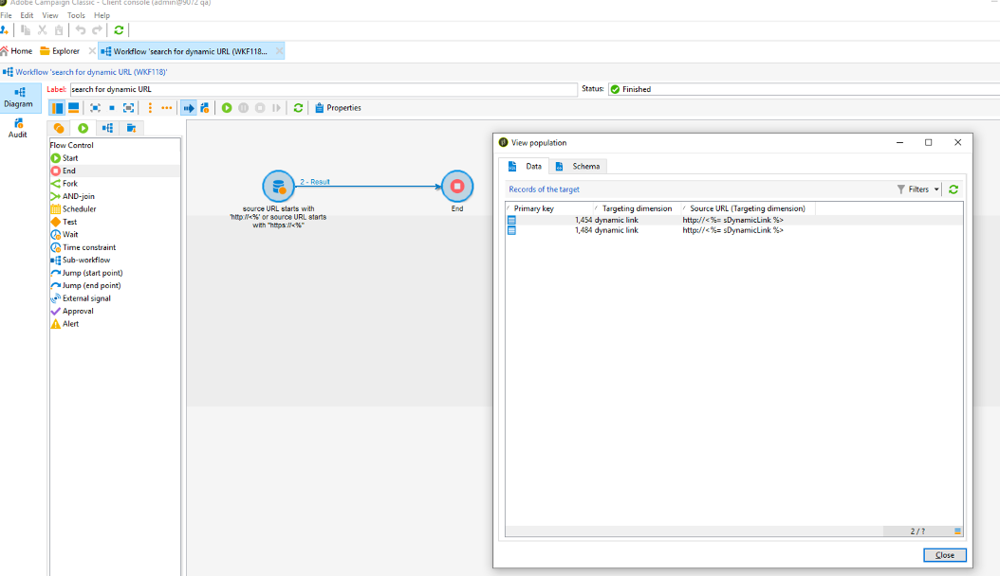

# 个性化和隐私 {#privacy}

本页介绍URL个性化、URL签名以及保护包含个人信息的页面。

>[!NOTE]
>
>作为从Campaign v7过渡到v8的一部分，Campaign Classic文档集已得到简化和重新组织。 现在，Campaign v8文档集中专门提供了常用功能。 要了解有关数据限制和隐私请求的更多信息，请参阅[Campaign v8文档](https://experienceleague.adobe.com/zh-hans/docs/campaign/campaign-v8/privacy/security#data-restriction){target=_blank}。
>
>[](https://experienceleague.adobe.com/zh-hans/docs/campaign/campaign-v8/privacy/security#data-restriction){target=_blank}

在Campaign Classic v7中，限制对整个实体的访问需要内部版本8770或更高版本。

## URL PERSONALIZATION {#url-personalization}

向内容添加个性化链接时，请始终避免在URL的主机名部分进行任何个性化设置，以避免潜在的安全缺口。 绝不应该在所有URL属性&lt;`a href="">`或``中使用以下示例：

* `<%= url >`
* `https://<%= url >`
* `https://<%= domain >/path`
* `https://<%= sub-domain >.domain.tld/path`
* `https://sub.domain<%= main domain %>/path`

### 推荐

要验证并确保未使用上述功能，请通过[Campaign通用查询编辑器](https://experienceleague.adobe.com/zh-hans/docs/campaign/campaign-v8/data/query/query-editor){target="_blank"}（Campaign v8文档）对跟踪URL表运行查询，或在查询活动中创建具有筛选条件的工作流。 请参阅[Campaign v8文档](https://experienceleague.adobe.com/docs/campaign/automation/workflows/wf-activities/targeting-activities/query.html?lang=zh-Hans){target="_blank"}。

示例：

1. 创建工作流并添加&#x200B;**查询**&#x200B;活动。 请参阅[Campaign v8文档](https://experienceleague.adobe.com/docs/campaign/automation/workflows/wf-activities/targeting-activities/query.html?lang=zh-Hans){target="_blank"}。

1. 打开&#x200B;**查询**&#x200B;活动并在`nmsTrackingUrl`表上创建筛选器，如下所示：

   `source URL starts with http://<% or source URL starts with https://<%`

1. 运行工作流并检查结果是否存在。

1. 如果是这样，请打开输出过渡以查看URL列表。

   


### URL签名

为了提高安全性，引入了一种用于跟踪电子邮件中链接的签名机制。 它从19.1.4版(9032@3a9dc9c)和20.2版开始提供。 此功能默认处于启用状态。

>[!NOTE]
>
>单击格式错误的签名URL时，返回此错误： `Requested URL '…' was not found.`

此外，您还可以使用增强功能来禁用在以前的内部版本中生成的URL。 默认情况下，此功能处于禁用状态。 您可以联系[客户关怀](https://helpx.adobe.com/cn/enterprise/admin-guide.html/enterprise/using/support-for-experience-cloud.ug.html)以启用此功能。

如果您在19.1.4内部版本上运行，则在使用跟踪链接或使用锚点标记进行投放时可能会遇到问题。 如果出现这种情况，建议您禁用URL签名。

作为活动托管、托管云服务或混合型客户，您必须联系[客户关怀](https://helpx.adobe.com/cn/enterprise/using/support-for-experience-cloud.html)以禁用URL签名。

如果您在混合架构中运行Campaign，则在启用URL签名之前，请确保已如下所示升级托管的中源实例：

* 首先是内部部署营销实例
* 然后，升级到与内部部署营销实例相同的版本或略高的版本

否则，可能会出现以下一些问题：

* 在升级中间源实例之前，将通过该实例发送URL，而不进行签名。
* 升级中间源实例并在两个实例上启用URL签名后，先前未签名发送的URL将被拒绝。 原因是营销实例提供的跟踪文件需要签名。

要禁用以前内部版本中生成的URL，请同时在所有Campaign服务器上执行以下步骤：

1. 在服务器配置文件(`serverConf.xml`)中，将&#x200B;**blockRedirectForUnsignedTrackingLink**&#x200B;选项更改为&#x200B;**true**。
1. 重新启动`nlserver`服务。
1. 在`tracking`服务器上，重新启动`web`服务器（Debian上的apache2、CentOS/RedHat上的httpd、Windows上的IIS）。

要启用URL签名，请同时在所有Campaign服务器上执行以下步骤：

1. 在服务器配置文件(`serverConf.xml`)中，将&#x200B;**signEmailLinks**&#x200B;选项更改为&#x200B;**true**。
1. 重新启动&#x200B;**nlserver**&#x200B;服务。
1. 在`tracking`服务器上，重新启动`web`服务器（Debian上的apache2、CentOS/RedHat上的httpd、Windows上的IIS）。

## 使用PI保护页面

我们强烈建议内部部署客户保护可能包含个人信息(PI)的页面，如镜像页面、Web应用程序等。

此过程的目标是防止对这些页编制索引，从而避免潜在的安全风险。 以下是一些有用的文章：

* [https://developers.google.com/search/reference/robots_txt](https://developers.google.com/search/reference/robots_txt)
* [https://developers.google.com/search/reference/robots_meta_tag](https://developers.google.com/search/reference/robots_meta_tag)

要保护您的页面，请执行以下步骤：

1. 在Web服务器（Apache或IIS）的根目录下添加`robots.txt`文件。 以下是文件的内容：

   ```sql
   # Make changes for all web spiders
   User-agent:
   *Disallow: /
   ```

   对于IIS，请参阅[此页面](https://docs.microsoft.com/en-us/iis/extensions/iis-search-engine-optimization-toolkit/managing-robotstxt-and-sitemap-files)。

   对于Apache，您可以将文件放在&#x200B;**/var/www/robots.txt** (Debian)中。

1. 有时添加&#x200B;**robots.txt**&#x200B;文件的安全性不够。 例如，如果其他网站包含指向您的页面的链接，则该链接可能会显示在搜索结果中。

   除了&#x200B;**robots.txt**&#x200B;文件外，还建议添加&#x200B;**X-Robots-Tag**&#x200B;标头。 您可以在Apache或IIS以及&#x200B;**serverConf.xml**&#x200B;配置文件中执行该操作。

   有关详细信息，请参阅[本文](https://developers.google.com/search/reference/robots_meta_tag)。
