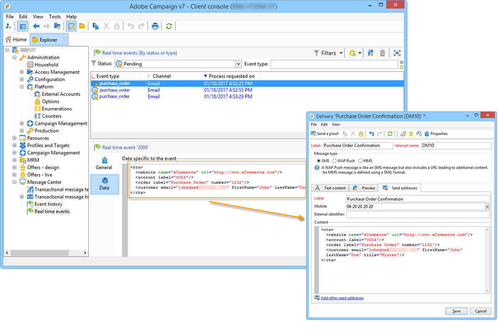

# 测试事务性消息模板 {#testing-message-templates}

准备好您的[消息模板](https://experienceleague.adobe.com/zh-hans/docs/campaign/campaign-v8/send/real-time/transactional-template){target="_blank"}（Campaign v8文档）后，请按照以下步骤预览和测试该模板。

作为从Campaign v7过渡到v8的一部分，Campaign Classic文档集已得到简化和重新组织。 现在，Campaign v8文档集中专门提供了常用功能。 要了解如何添加种子地址、预览事务型消息以及发送校样，请参阅[Campaign v8文档](https://experienceleague.adobe.com/zh-hans/docs/campaign/campaign-v8/send/real-time/transactional-template#test-message-template){target=_blank}。

{target=_blank}

## 个性化数据 {#personalization-data}

可以在消息模板中使用数据来测试事务型消息个性化。 此功能用于生成预览或发送验证。 您还可以为各种Internet访问提供商显示消息的呈现。 有关此内容的详细信息，请参阅[收件箱呈现](../../delivery/using/inbox-rendering.md)。

此数据的目的是在最终投放之前测试您的消息。 这些消息与要处理的实际数据不一致。 但是，XML结构必须与执行实例中存储的事件的结构相同，如下所示：

此信息允许您使用个性化标记个性化消息内容(有关更多信息，请参阅[创建消息内容](https://experienceleague.adobe.com/zh-hans/docs/campaign/campaign-v8/send/real-time/transactional-template#create-message-content){target="_blank"}（Campaign v8文档）。

1. 选择事务型消息模板。

1. 在模板中，单击&#x200B;**[!UICONTROL Seed addresses]**&#x200B;选项卡。

1. 在事件内容中，以XML格式输入测试信息。

   

1. 单击 **[!UICONTROL Save]**。
